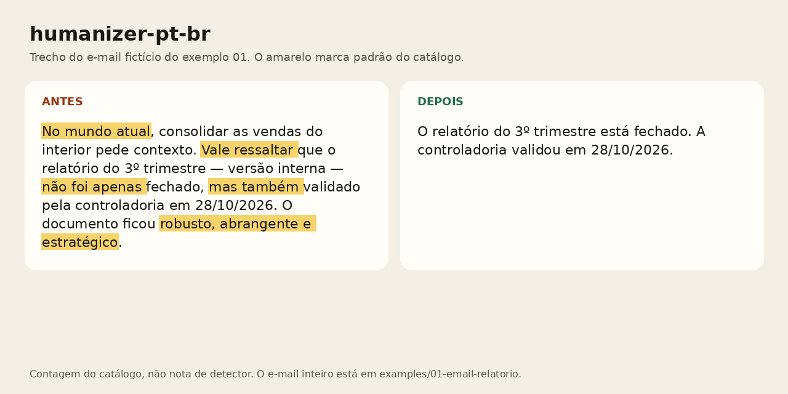

# humanizer-pt-br

Make Claude, Codex and Cursor write Brazilian Portuguese that does not read as machine-made.

Faça o Claude, o Codex e o Cursor escreverem português do Brasil sem cara de texto de máquina.



<!-- eval-stats:start -->
**45 padrões.** Nos 30 textos gerados para este repositório, a média de marcas por texto caiu de **5,93** para **0,00** ([eval/RESULTS.md](eval/RESULTS.md)). No controle de 30 trechos em domínio público, a média é **0,03**.
<!-- eval-stats:end -->

Isso é contagem das heurísticas deste catálogo, não nota de detector. A avaliação cega com leitores brasileiros está em [eval/cego.md](eval/cego.md) e ainda não foi feita.

A skill lê o texto, marca os padrões, reescreve sem mexer em fato, número, nome ou termo técnico, e devolve a lista do que saiu.

## Instalar

Cada caminho abaixo leva cerca de um minuto. Os três formatos saem do mesmo catálogo: `scripts/build.py` gera a skill e o prompt, e o CI falha se alguém editar um dos dois à mão.

### Claude Code

```bash
mkdir -p ~/.claude/skills
cp -R skills/humanizer-pt-br ~/.claude/skills/
```

Para valer só neste projeto, troque `~/.claude/skills` por `.claude/skills`. O arquivo que o Claude lê é [skills/humanizer-pt-br/SKILL.md](skills/humanizer-pt-br/SKILL.md). O formato segue a [especificação de Agent Skills](https://agentskills.io/specification).

### Codex e Cursor

Cole [prompt/humanizer-pt-br.md](prompt/humanizer-pt-br.md) no `AGENTS.md` do Codex, ou numa rule do Cursor (`.cursor/rules/humanizer-pt-br.mdc`). Na rule, use a descrição da skill para ela entrar quando o pedido for revisar português.

### Qualquer chatbot

Abra um chat novo, cole o mesmo prompt e, na mensagem seguinte, o texto. Serve para ChatGPT, Gemini, Claude na web ou outro modelo que aceite instrução longa.

## Padrões

<!-- patterns-table:start -->
| Padrão | Exemplo |
| --- | --- |
| Abertura «em um mundo» e «na era digital» | Em um mundo conectado, a padaria do seu Paulo passou a anotar encomenda no celular. |
| Abertura «no mundo atual» | No mundo atual, a planilha de vendas do interior virou prioridade da área. |
| Pergunta retórica de abertura | Você já parou para pensar por que a fila do pão dobra às 7h? |
| «Desde os primórdios» | Desde os primórdios da informática, dígitos verificadores evitam erro de digitação. |
| «Espero que esta mensagem o encontre bem» | Espero que esta mensagem a encontre bem. Segue o comprovante do boleto 1022. |
| «Mais do que nunca» | Mais do que nunca, a meta de novembro pede atenção: são R$ 220 mil. |
| «Neste artigo vamos» | Neste artigo, vamos explorar como conferir o dígito do CPF. Ao longo deste guia, o es… |
| «Vamos mergulhar» e «vamos explorar» | Vamos mergulhar nos preparativos: o churrasco é sábado, ao meio-dia, na casa do tio L… |
| «Você sabia que» | Você sabia que o pão francês fica a R$ 1,25 até sábado? |
| «Além disso» e «ademais» empilhados | O café da sessão está incluso. Além disso, a loja fica na rua Halfeld. Ademais, o clu… |
| «Como mencionado acima» | Como mencionado acima, o desbloqueio é no balcão, com RG. |
| «Em última análise» | Em última análise, a vírgula é o que separa o convite do almoço. |
| «Nesse sentido» e «dito isso» | Diante desse cenário, a entrega do arquivo fica para as 10h. Nesse sentido, seguimos… |
| «No que diz respeito a» | No que diz respeito à meta de novembro, o valor combinado é R$ 220 mil. |
| «Outro ponto importante» | Outro ponto importante é a falta de Diego e Ruth na unidade Moema. |
| «Vale ressaltar» | Vale ressaltar que o relatório foi validado pela controladoria em 28/10/2026. |
| «É importante destacar» | É importante destacar que o protocolo 55219 está com a Marina, do financeiro. |
| Gerundismo «vou estar enviando» | Vou estar enviando o desenho ainda hoje e vamos estar verificando o saldo. |
| Gerúndio de intenção em cadeia | O time segue buscando cruzar os lançamentos e garantindo uma visão única da planilha. |
| Travessão no meio da frase | O relatório — versão interna — saiu ontem, e as pendências — todas de Barretos — cont… |
| Tríade de adjetivos vazios | O relatório do 3º trimestre entregue é robusto, abrangente e estratégico. |
| «Não apenas… mas também» | O relatório não foi apenas fechado, mas também validado pela controladoria. |
| Calque «alavancar» e «entregar valor» | No final do dia, o plano de novembro precisa alavancar vendas e entregar valor. |
| Calque «endereçar o problema» | O suporte vai endereçar o problema do boleto ainda hoje. |
| «Abordagem holística» | O fechamento pede uma abordagem holística e uma visão 360 da planilha. |
| «Compromisso com a excelência» | Nosso compromisso com a excelência: consulta de cão e de gato, sem internação. |
| «De forma eficaz» | O time vai cruzar as notas de forma eficaz e de maneira estratégica. |
| «Ecossistema» fora da biologia | Nosso ecossistema digital junta o plano de fibra e o suporte por WhatsApp. |
| «Gerar impacto» | A oficina de 40 minutos foi desenhada para gerar impacto positivo: cada pessoa traz u… |
| «Jornada» metafórica | A promoção abre uma jornada de sucesso na coordenação. |
| «Papel fundamental» | A controladoria desempenha um papel fundamental na validação do relatório. |
| «Ponta a ponta» e «solução completa» | A biblioteca é uma solução completa, ponta a ponta, para CPF: confere o dígito, forma… |
| «Potencializar» e «otimizar resultados» | Seguimos potencializando o fechamento da folha de novembro e otimizando resultados. |
| «Robusto» e «abrangente» | A garrafa Serra Fria tem corpo robusto e uma proposta abrangente: 500 ml, aço inox 304. |
| «Sinergia» | O fechamento da folha depende da sinergia entre o DP e o compras. |
| «Sob medida para você» e «experiência única» | A aula experimental dura 30 minutos, custa R$ 40 e é uma experiência única, sob medid… |
| «Uma gama de fatores» | Uma série de fatores explica os 36 itens que ficaram só no celular. |
| Fechamento motivacional | O bolo é sexta, no pátio, depois das 18h. Juntos, podemos mais. O futuro é promissor.… |
| «A verdade é que» | A verdade é que a conta de luz da padaria não baixou em 2018. |
| «Desafios e oportunidades» | O trimestre traz desafios e oportunidades: faltam Diego e Ruth, e a meta é R$ 220 mil. |
| «Em suma» mecânico | Em suma, o arquivo segue amanhã às 10h. |
| «Não pode ser subestimada» | A importância da vírgula não pode ser subestimada: sem ela, «vamos comer crianças» de… |
| «Não é segredo que» | Não é segredo que o time de DP tem 6 pessoas. |
| Fileira de emoji de modelo | A clínica abre em novembro. 🚀✨ Agende na recepção. |
| Título com maiúsculas de inglês | Como Validar CPF Em Python Com Clareza |
<!-- patterns-table:end -->

O verbete completo, com o porquê, a correção e o antes/depois, está em [skills/humanizer-pt-br/references/catalogo.md](skills/humanizer-pt-br/references/catalogo.md). A fonte editável é um arquivo por padrão em [`patterns/`](patterns/abertura-mundo-atual.yaml).

## Exemplos

Dez textos fictícios, um por gênero. O «antes» foi escrito por Grok 4.7 em 2026-10-29 para este repositório. O «depois» é a reescrita do mesmo modelo, no mesmo dia, seguindo a skill. Modelo, data e prompt estão no `meta.yaml` de cada pasta.

| Gênero | Antes | Depois |
| --- | --- | --- |
| E-mail de trabalho | [antes](examples/01-email-relatorio/antes.md) | [depois](examples/01-email-relatorio/depois.md) |
| Post de LinkedIn | [antes](examples/03-linkedin-promocao/antes.md) | [depois](examples/03-linkedin-promocao/depois.md) |
| README | [antes](examples/05-readme-cpf/antes.md) | [depois](examples/05-readme-cpf/depois.md) |
| Resposta de suporte | [antes](examples/07-suporte-boleto/antes.md) | [depois](examples/07-suporte-boleto/depois.md) |
| Artigo de opinião | [antes](examples/09-opiniao-horario/antes.md) | [depois](examples/09-opiniao-horario/depois.md) |
| Legenda de Instagram | [antes](examples/11-instagram-padaria/antes.md) | [depois](examples/11-instagram-padaria/depois.md) |
| Mensagem de WhatsApp | [antes](examples/13-whatsapp-agua/antes.md) | [depois](examples/13-whatsapp-agua/depois.md) |
| Texto acadêmico curto | [antes](examples/15-academico-compostagem/antes.md) | [depois](examples/15-academico-compostagem/depois.md) |
| Descrição de produto | [antes](examples/17-produto-garrafa/antes.md) | [depois](examples/17-produto-garrafa/depois.md) |
| Release de imprensa | [antes](examples/19-release-vet/antes.md) | [depois](examples/19-release-vet/depois.md) |

Nada disso é comunicado real de empresa, clínica ou prefeitura.

## Eval

O conjunto tem 30 textos de IA (os dez acima e mais vinte) e 30 parágrafos em domínio público, anteriores a 1930. O script [`eval/detector.py`](eval/detector.py) conta as heurísticas antes e depois e confere se número e nome sobreviveram. O relatório é [eval/RESULTS.md](eval/RESULTS.md).

O controle humano não é e-mail de 2026. É prosa de Machado de Assis, Aluísio Azevedo, Lima Barreto e Raul Pompeia, para ver se a regex dispara em texto de gente. Fonte e licença: [eval/textos/humano/FONTES.md](eval/textos/humano/FONTES.md).

A rodada cega, com leitor dizendo «parece IA» ou «parece humano», não aconteceu. Quando acontecer, o README ganha N, data e taxa. Até lá, só o número automático.

## Contribuir

Um padrão novo precisa aparecer em texto de pelo menos dois modelos, com exemplo de origem limpa e correção que não muda o sentido. O passo a passo está em [CONTRIBUTING.md](CONTRIBUTING.md).

## Créditos

A ideia de uma skill que lista vícios de texto de máquina e reescreve em cima deles vem de [blader/humanizer](https://github.com/blader/humanizer). Também existem os ports [op7418/Humanizer-zh](https://github.com/op7418/Humanizer-zh) e [mackswendhell/humanizer-pt-br](https://github.com/mackswendhell/humanizer-pt-br). O catálogo daqui foi escrito do zero, em português do Brasil. A checagem de n-gramas contra os `SKILL.md` públicos desses três repos está em [docs/originalidade.md](docs/originalidade.md).

## Como foi feito

IA escreveu e testou este repositório (Grok 4.7, no Cursor, em 2026-10-29). O dono ainda não revisou padrão por padrão. O relato está em [docs/como-foi-feito.md](docs/como-foi-feito.md).

## Licença

[MIT](LICENSE). Os trechos literários do controle humano continuam em domínio público, como registrado em cada arquivo.

## English

This is a skill that rewrites Brazilian Portuguese so it drops the usual machine-written tics: empty openers, stacked connectors, hollow adjectives, English-style title case, and the motivational closer. Facts, names, numbers, and technical terms stay.

Install the folder `skills/humanizer-pt-br` as a Claude Code skill, or paste `prompt/humanizer-pt-br.md` into Codex, Cursor, or any chatbot. Both files are generated from `patterns/` by `scripts/build.py`.

The headline number counts this repo's own heuristics on 30 texts written for the project. It is not a score from an external AI detector, and the blind reader study has not been run. Details, in Portuguese, are in `eval/RESULTS.md`. License: MIT.
